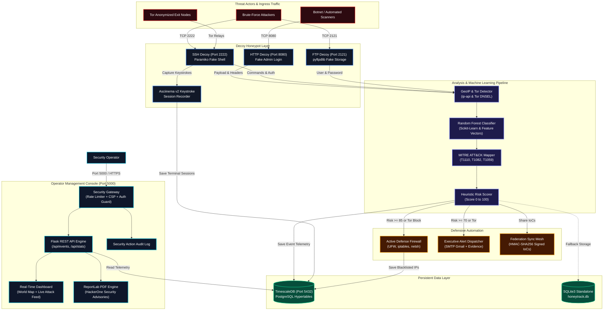

# 🍯 HoneyTrack — Architecture & Tech Stack Specification

This document details the complete technology stack, system architecture, and end-to-end data flow for **HoneyTrack: Real-Time Honeypot Intelligence & Active Defense Platform**.

---

## 🛠️ Technology Stack Breakdown

| Architectural Layer | Component | Technology / Library | Role & Functionality |
| :--- | :--- | :--- | :--- |
| **Decoy Honeypots** | SSH Decoy | `Paramiko (5.0.0)` | Emulated root shell, auth capture, keystroke session recorder (Port 2222) |
| | HTTP Decoy | `Flask (3.1.3)` | Fake admin login portal capturing credentials & user agents (Port 8080) |
| | FTP Decoy | `pyftpdlib (2.2.0)` | Fake file storage, credential interception, anonymous trap (Port 2121) |
| **Intelligence Engine** | Feature Pipeline | `NumPy`, `Regex`, Shannon Entropy | Obfuscation detection, command tokenization, frequency scoring |
| | Attack Classifier | `Scikit-Learn` (Random Forest) | Categorizes attacks into 8 classes + MITRE ATT&CK mapping |
| | Geolocation & Tor | `ip-api.com`, `Tor Project DNSEL` | Real-time country/city/ISP resolution & Tor Exit node cache |
| | Risk Scorer | Custom Heuristic Engine | Scores threat level from 0 to 100 based on adversary behavior |
| **Defensive Actions** | Active Firewall | `UFW`, `iptables`, `Windows netsh` | Automated threat dropping & copyable host firewall rules |
| | Email Alerts | `smtplib`, `email.mime` | Async executive incident dispatches with embedded forensic evidence |
| | Node Federation | `HMAC-SHA256`, `requests` | Cross-node IoC synchronization & collaborative mesh defense |
| **Data & Storage** | Primary Engine | **TimescaleDB / PostgreSQL 16** | High-throughput time-series hypertables with zero-lock concurrency |
| | Standalone Engine | **SQLite3** | Local zero-dependency database for fast test deployments |
| | ORM & Pooling | `SQLAlchemy (2.0.52)` + `psycopg 3` | Parameterized SQL queries, connection pooling, dynamic migrations |
| **Operator Console** | Web Framework | `Flask`, `Flask-Cors` | Authenticated management portal & REST API (Port 5000) |
| | Security Suite | In-memory sliding rate limiter | Brute-force protection, CSP, security headers, audit logging |
| | PDF Generator | `ReportLab (5.0.1)` | Tactical HackerOne-styled cybersecurity incident reports |
| | Frontend UI | `Vanilla JS`, `Leaflet.js`, `CartoDB` | Dark-mode interactive world map, real-time live attack feed |
| **DevOps & Deploy** | Containerization | `Docker (Multi-stage)`, `Compose` | 1-command deployment with profiles (`default`, `timescale`) |
| | Automation | `deploy.ps1`, `deploy.sh` | Cross-platform one-click automated bootstrap scripts |

---

## 🌊 System Architecture & Data Flow Diagram

---

## 🔁 Execution Sequence Diagram

```mermaid
sequenceDiagram
    autonumber
    actor Attacker as Adversary / Botnet
    participant Decoy as Honeypot Listeners (SSH/HTTP/FTP)
    participant Pipeline as Analysis & ML Classifier
    participant DB as TimescaleDB / SQLite
    participant Defense as Active Defense (Firewall & Alerts)
    participant Console as Operator Dashboard

    Attacker->>Decoy: Inbound connection & credential / command payload
    Decoy->>Pipeline: Raw telemetry (IP, Port, Payload, Headers)
    
    rect rgb(20, 25, 45)
        Note over Pipeline: Enrichment & Attribution
        Pipeline->>Pipeline: Resolve Country, City, ISP & Tor Relay Check
        Pipeline->>Pipeline: Extract Shannon Entropy & Numeric Features
        Pipeline->>Pipeline: Random Forest ML predicts attack type
        Pipeline->>Pipeline: Map to MITRE ATT&CK & Calculate 0-100 Risk Score
    end

    Pipeline->>DB: INSERT into attack_events (Time-Series Hypertable)
    
    alt Risk Score >= 85 (Critical Incursion)
        Pipeline->>Defense: Auto-Blacklist IP in active defense cache
        Defense->>Defense: Generate UFW / iptables / netsh drop rules
    end

    alt Risk Score >= 70 (Executive Alert)
        Pipeline->>Defense: Dispatch asynchronous HTML forensic alert email
    end

    Console->>DB: Poll /api/events/latest & /api/stats
    DB-->>Console: Stream enriched coordinates, risk scores, and attack types
    Console-->>Console: Pulse attack marker on Leaflet World Map & update live feed
```

